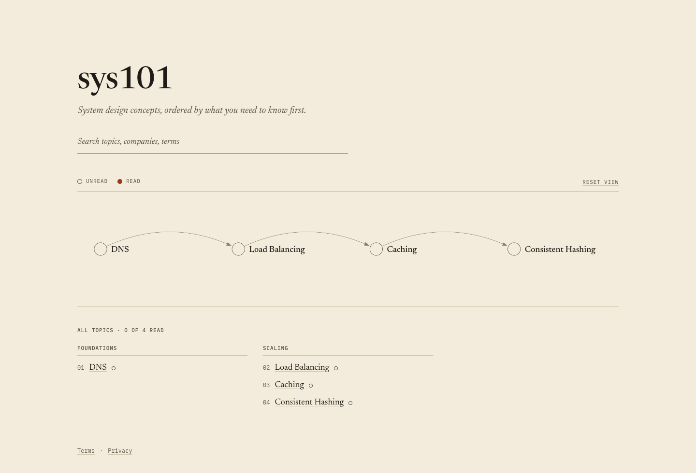

# sys101

A system design course built as a prerequisite graph, taught through how real companies engineered each concept.



Live at [sys101.vercel.app](https://sys101.vercel.app).

## Why this exists

Learning system design from engineering blogs is hard because nothing tells you which post to read first, or what you need to know before it makes sense. Good posts assume background that a different post explains. sys101 orders concepts by their prerequisites and attaches vetted engineering posts to each one, so there is always a clear next thing to read.

## Topics

Ten topics across four groups. Each topic lists what it builds on and the company posts digested on its page.

| Group | Topic | Builds on | Posts from |
|---|---|---|---|
| Foundations | Databases | none | Uber (2016), GitHub |
| Foundations | DNS | none | Cloudflare, Slack |
| Scaling | Load Balancing | DNS | Uber, Dropbox |
| Scaling | Caching | Load Balancing | Meta, Uber |
| Scaling | Consistent Hashing | Caching | Cloudflare, Discord (2017) |
| Scaling | CDNs | DNS, Caching | Cloudflare, Netflix (2017) |
| Data | Database Replication | Databases | Meta, GitHub (2018) |
| Data | Sharding and Partitioning | Database Replication, Consistent Hashing | Figma, Notion |
| Data | Indexing and Search | Databases, Sharding | GitHub, Discord |
| Messaging | Message Queues | Sharding | Slack (2017), Meta |

Years are shown for posts more than five years old; each topic page explains why they still apply.

## How it works

1. **The graph is the homepage.** Each node is a topic, and arrows point from what you should read first to what builds on it. A hollow node is unread, a node with a dot is ready to read (all its prerequisites are done), and a filled node is read. "Next up" suggests where to go, preferring topics that continue what you already read and that open up more of the map.
2. **Each topic page is a lesson.** It has two halves. First the idea: why the concept exists, a mental model with a diagram, how it works step by step, a worked example, the common mistakes, a self-check quiz with explained answers, and a "skip to the posts" link for people who already know it. Then the real world: a digest of each company post (problem, constraints, walkthrough, diagram, numbers, trade-offs, what failed, takeaways), a comparison when there are two or more posts, and design exercises that rise in difficulty (apply, design, scale) with model answers.
3. **"Start from zero" learn pages** give an absolute beginner a staged path through a topic (Basics, How it works, Going deeper, In practice and trade-offs), built only from official sources: standards, vendor and project docs, university course pages, and recognized conference talks. Each stage cites its sources inline, points to the exact section to read, and ends with what you can now do. Piloted on DNS at `/topic/dns/learn`.
4. **Reading progress is stored in your browser only.** Nothing is sent to a server, and there are no accounts. Section-level, post-level and quiz progress are tracked per topic, with a progress bar on each page. You can export, import, or reset it on the `/data` page.

## How posts are chosen

A post is included only if it passes most of these:

1. **Specific.** Real numbers: latency, throughput, request volume, error rates.
2. **Honest about trade-offs.** What was tried, what failed, and why the final design won.
3. **Still relevant.** Describes architecture in use today. A post older than about five years passes only if it teaches a fundamental that has not changed, and its year is shown on the page via an `ageNote`.
4. **Credible.** Written by the engineering team that runs the system at scale. No listicles or marketing posts.
5. **Transferable.** Teaches something that applies to a concept in the graph.

## Architecture

```
content/topics/*.json ──► next build ──► static HTML + Pagefind index ──► CDN (Vercel)
content/learn/*.json  ──►     │
        ▲                     ├── fails on missing prerequisites, cycles, or empty sections
        │                     └── postbuild SEO check fails on bad titles/canonicals/headings/sitemap
pipeline/ (offline, run by hand)
  fetch RSS ──► extract text ──► draft digests ──► human review ──► commit JSON
```

The site is read-heavy and its content changes rarely, so every page is generated at build time and served as static files from a CDN, with search running in the browser against a prebuilt index. The content pipeline is decoupled from the site and idempotent: it only produces JSON for review, so a failed or repeated run never affects what readers see.

## Build-time checks

Content is validated during static generation (`lib/topics.ts`, `lib/learn.ts`); a bad file fails the build instead of shipping a broken page. The build fails if:

- a topic lists a prerequisite or related topic with no topic file, or prerequisites form a cycle;
- any section is empty, including each post's digest, the glossary, or a lesson section;
- a lesson's quiz has fewer than 5 or more than 8 questions, or an answer does not explain each wrong option; a lesson needs 2 to 3 exercises rising in difficulty;
- a classic (non-lesson) topic's quiz has fewer than 3 or more than 5 questions, or has no exercise;
- a lesson is missing a diagram on its Mental model, How it works or Worked example section, or any post digest has no diagram;
- a diagram uses gradients, filters, shadows or scripts, or lacks a `viewBox` and a `<title>`;
- `verifiedOn` or `published` is missing or in the future, or a post over five years old has no `ageNote`;
- a learn page is missing its four stages, cites an unknown source, or has a stage with no official written source.

A separate SEO check (`scripts/check-seo.mjs`) runs after `next build` and fails on: duplicate or over-length titles and descriptions, a page without exactly one `<h1>`, headings that skip a level, a missing or wrong canonical, a page that should be `noindex` but is not (`/data`, 404), a sitemap that does not match the indexable pages, JSON-LD that does not parse, images without alt/width/height, and content streamed in a hidden chunk that needs JavaScript.

## Link checks

Every post records `verifiedOn`, the date someone last opened it and checked the digest, and each source link shows "Checked on <date>". A GitHub Action (`.github/workflows/link-check.yml`) requests every source URL each Monday and keeps one "Source links failing" issue in sync: it opens the issue, rewrites it on later runs, and closes it once every link passes, so reruns never duplicate it. Pages never fetch sources at runtime, so a dead link only affects the outbound link. Run it locally with `node scripts/check-links.mjs`.

## Stack

- Next.js (App Router) and TypeScript, every page statically generated
- Sigma.js and graphology for the graph (with node borders and curved edges)
- Pagefind for search, built into static files at build time
- Vercel for hosting and Vercel Analytics for traffic
- Vitest for the unit tests in `lib/`
- Pipeline in Node with rss-parser, Cheerio and Gemini Flash (`@google/genai`); scaffolded, not yet in use

## Project structure

```
app/              routes: graph homepage, topic pages, learn pages, about, data, terms, privacy, sitemap, robots
components/       graph view, topic lesson, learn page, index, search, progress trackers, data controls
content/topics/   one JSON file per topic (10 topics)
content/learn/    one JSON file per "start from zero" learn page (DNS pilot)
lib/              content loading and build checks, graph layout, reading progress, SEO helpers, and their tests
pipeline/         offline scripts for fetching and summarizing posts
scripts/          weekly source link check and the postbuild SEO check
.github/          the scheduled link-check workflow
public/           static files; public/pagefind is generated by the build
docs/             images and design notes for this project
```

## Run locally

Requires Node 20.9 or newer (`package.json` sets `engines.node >= 20.9`; see also `.nvmrc`).

```
npm install
npm run dev            # http://localhost:3000
npm run search:index   # build the search index for local dev; rerun after content changes
npm run build          # static build, then the SEO check and the Pagefind index
npm test               # run the Vitest unit tests
```

## Adding a topic

Create `content/topics/<slug>.json`. Topics use the lesson format (`why`, `mentalModel`, `howItWorks`, `workedExample`, mistakes, a 5-to-8 question `quiz`, `posts`, a `comparison`, and 2-to-3 `exercises`); the older `primer`/`quiz`/`exercise` format is still supported for non-lesson topics. A shortened lesson example:

```json
{
  "slug": "cdn",
  "title": "CDNs",
  "group": "Scaling",
  "concept": "Two to four sentences on the idea itself.",
  "prerequisites": ["dns", "caching"],
  "lesson": {
    "why": { "outcome": "After this you can ...", "body": "..." },
    "mentalModel": { "outcome": "After this you can ...", "body": "...", "diagram": "<svg viewBox=\"0 0 560 300\"><title>...</title>...</svg>" },
    "howItWorks": { "outcome": "After this you can ...", "steps": [{ "step": "...", "explanation": "..." }], "diagram": "<svg viewBox=\"0 0 560 300\"><title>...</title>...</svg>" },
    "workedExample": { "outcome": "After this you can ...", "steps": [{ "step": "...", "explanation": "..." }], "diagram": "<svg viewBox=\"0 0 560 300\"><title>...</title>...</svg>" },
    "mistakesOutcome": "After this you can ...",
    "checkOutcome": "After this you can ...",
    "quiz": [{ "question": "...", "options": ["..."], "correct": 0, "why": "...", "wrong": ["..."], "teaches": "why" }],
    "postsOutcome": "After this you can ...",
    "differOutcome": "After this you can ...",
    "exercisesOutcome": "After this you can ...",
    "exercises": [{ "level": "apply", "prompt": "...", "answer": "...", "tradeoffs": "...", "wrongAnswers": ["..."], "teaches": "how" }],
    "next": { "outcome": "After this you can ...", "body": "..." }
  },
  "posts": [{
    "id": "cdn-cloudflare", "title": "Post title", "url": "https://...", "company": "Company",
    "verifiedOn": "2026-10-11", "published": "2024-03-14",
    "digest": {
      "problem": "...", "constraints": "...",
      "walkthrough": [{ "step": "...", "explanation": "..." }],
      "diagram": "<svg viewBox=\"0 0 560 300\"><title>...</title>...</svg>",
      "numbers": [{ "value": "...", "meaning": "..." }],
      "tradeoffs": { "chosen": "...", "rejected": "...", "why": "..." },
      "failures": "...", "takeaways": "..."
    }
  }],
  "comparison": "How the posts' approaches differ and why.",
  "glossary": [{ "term": "...", "definition": "..." }],
  "mistakes": ["...", "...", "..."]
}
```

Before committing:

- Every prerequisite already exists as a topic.
- The post passes the selection rules above.
- The digest is written in your own words from the post itself, with no copied passages.
- Every number is checked against the post. Never estimate or round in a way the post does not.
- A post over five years old has an `ageNote` saying why it still applies, without claiming details still hold unless a source you opened says so.

## Content and attribution

Every post belongs to its authors. The digests are original write-ups of what each post says, drafted with AI assistance and checked against the originals, and every topic page links to the original. To have a post removed or a digest corrected, email aditya01khandelwal@gmail.com.

## Roadmap

- More "start from zero" learn pages beyond the DNS pilot
- Sync reading progress across devices
- Interview-relevance tags on topics
- Staleness review driven by link-check results and post age
- An LLM pipeline (Gemini Flash) to draft digests and comparisons for review

## License

All rights reserved.
