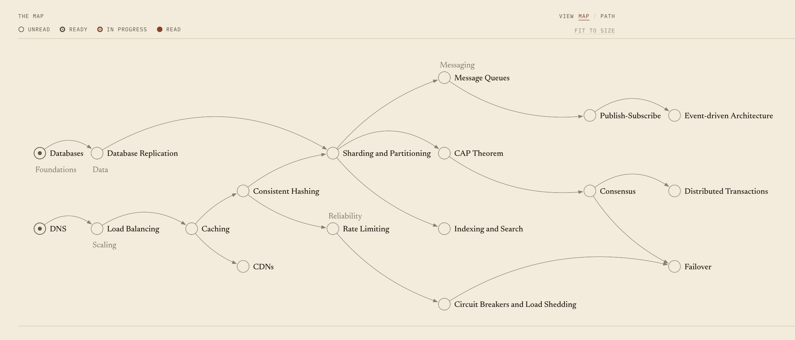
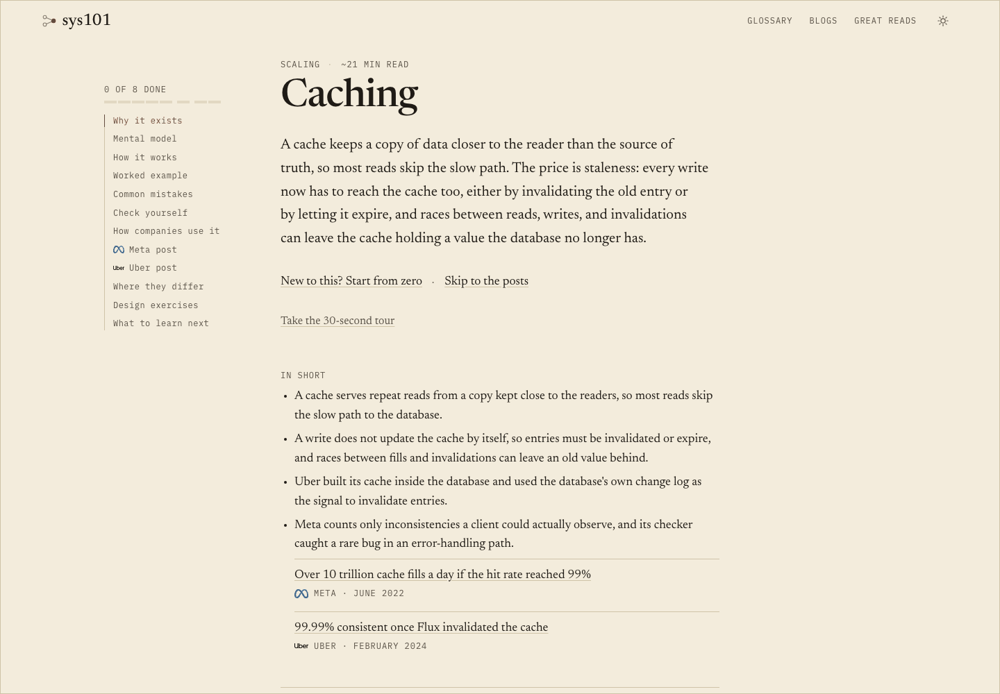
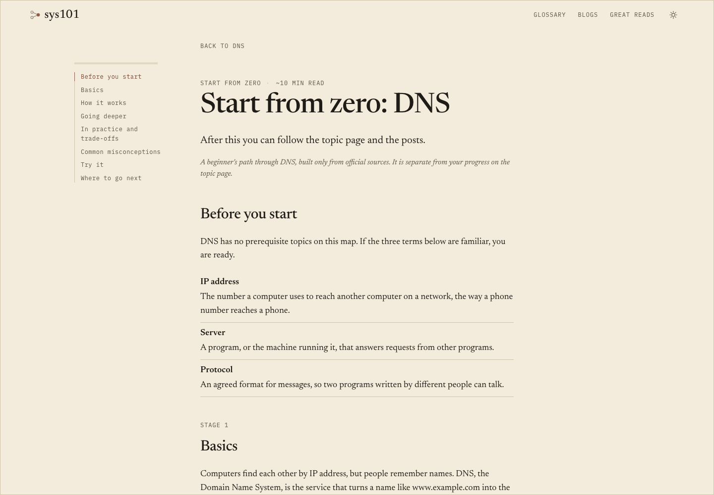
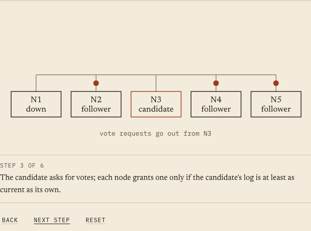
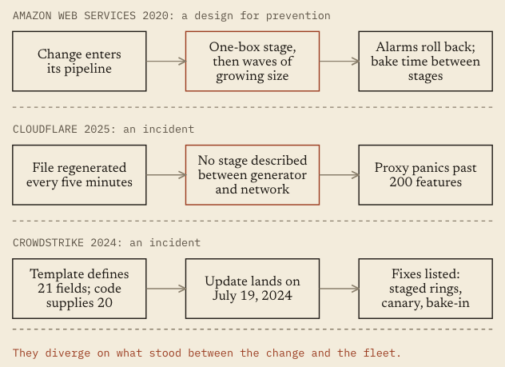
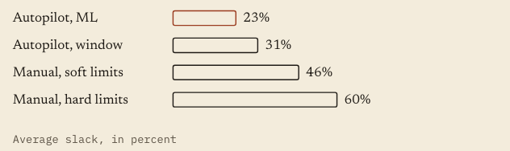

<h1 align="center">sys101</h1>

<p align="center"><strong>Learn system design from what real companies built, broke and fixed.</strong></p>

<p align="center">
  <a href="https://sys101.vercel.app">Open the site</a> &nbsp;|&nbsp;
  <a href="https://sys101.vercel.app/capstones">Capstones</a> &nbsp;|&nbsp;
  <a href="https://sys101.vercel.app/glossary">Glossary</a> &nbsp;|&nbsp;
  <a href="https://sys101.vercel.app/reads">Great reads</a>
</p>

| Topics | Sources | Organizations | Great reads |
| :-: | :-: | :-: | :-: |
| <!--stat:topics-->34<!--/stat--> | <!--stat:sources-->81<!--/stat--> | <!--stat:organizations-->29<!--/stat--> | <!--stat:reads-->30<!--/stat--> |

<picture>
  <source media="(prefers-color-scheme: dark)" srcset="docs/readme/map-dark.png">
  
</picture>

---

## What it is

Behind most systems you use is a team that got it wrong first: a database that outgrew its server, a cache that took the site down, a retry storm nobody saw coming. They wrote it up, and those posts are a goldmine. They are also hard to use, because each blog assumes background that a different post explains, and nothing says which to read first.

sys101 puts them in order. It is a map of <!--stat:topics-->34<!--/stat--> system design topics, each one placed after the topics it depends on and taught through engineering posts picked from the teams that ran the system. Every topic has its own explanation, a quiz and design exercises. The posts come from <!--stat:sources-->81<!--/stat--> sources by <!--stat:organizations-->29<!--/stat--> organizations (<!--stat:kinds-->65 engineering posts, 13 research papers and 3 documentation pages<!--/stat-->), and a separate Great reads list holds <!--stat:reads-->30<!--/stat--> influential posts and papers in <!--stat:themes-->5<!--/stat--> themes.

It is one person's learning project, built in the open.

---

## How it works

**The map and the Path.** On a wide screen the homepage is a map. Each topic sits to the right of what it builds on, so you start at the left and work across. On a phone the same order is a list, the Path. A topic is ready once you have read what it needs, and one button always says where to go next.

<picture>
  <source media="(prefers-color-scheme: dark)" srcset="docs/readme/topic-dark.png">
  
</picture>

**Topics built on topics.** Each topic page names its prerequisites and says why each one matters. The page runs from the idea (why it exists, a mental model, a worked example, common mistakes) to the real world: a digest of each company post with its numbers, trade-offs and what failed.

**Check yourself.** Every topic ends with a quiz that explains the wrong answers too, and design exercises that rise from applying the idea to designing and scaling a system, with model answers you open when you are ready.

**Start from zero.** Every topic also has a beginner's path at `/topic/<slug>/learn`, built only from official sources: standards, project and vendor docs, university courses and recognised conference talks.

<picture>
  <source media="(prefers-color-scheme: dark)" srcset="docs/readme/learn-dark.png">
  
</picture>

**Put it together.** Capstones at `/capstones` combine finished topics into one system, a metrics pipeline, a social graph store, a payments ledger, a file sync engine and a chat and messaging system: decide first, size it with a calculator, click through the diagram, break it, compare with the real design, then a quiz. Each shows which of its topics you have read.

**Terms in place.** The first use of a topic's own terms in each section opens a short definition, with a link to the Glossary.

**Progress stays in your browser.** There are no accounts and nothing is sent to a server. You can export, import or reset what you have marked on the Your data page.

---

## Learn by seeing it

Every idea comes with a picture, and the pictures are original, drawn for this site, never copied from a blog. A topic page opens with the problem as a drawing, then a mental model, how it works, a worked example, the three common mistakes and each design exercise's model answer. The pages that compare companies put their designs side by side, and where a post's numbers share a unit they become a bar chart.

<picture>
  <source media="(prefers-color-scheme: dark)" srcset="docs/readme/step-dark.png">
  
</picture>

**Step through it.** Some of the harder flows, such as a cache read, a leader election or two-phase commit, play one frame at a time with Back, Next step and Reset, or the arrow keys. Nothing moves on its own.

<picture>
  <source media="(prefers-color-scheme: dark)" srcset="docs/readme/compare-dark.png">
  
</picture>

**Side by side.** Where two or more companies solved the same problem, a lane for each shows where their designs split.

<picture>
  <source media="(prefers-color-scheme: dark)" srcset="docs/readme/chart-dark.png">
  
</picture>

**Numbers you can compare.** A chart appears only where a post's figures share one unit, bars are drawn exactly in proportion, and the build rejects any figure in a chart that is not in the post's numbers. Most posts have no chart, on purpose.

Diagrams also sit in the Glossary, on the Background page, and in the capstone, where the company's real choice appears only after you pick your own.

---

## How the content stays honest

A post gets in only if it has real numbers, is honest about what was tried and what failed, describes a system that still looks like that (an older post shows its year and says why it still applies), comes from the team that runs the system at scale, and teaches something that carries to another concept on the map. Papers by a company's engineers count as posts and are labelled as papers. The full rules are in [CLAUDE.md](CLAUDE.md).

What is checked, and by what:

**Figures match the original pages.** `npm run verify:figures` fetches each source and looks for every number in the raw page text. Results go in [docs/verification-log.md](docs/verification-log.md). By hand, and it needs the network.

**Numbers a script cannot judge.** Lone digits and numbers written as words are read against the source by a person and recorded in [docs/hand-checks.json](docs/hand-checks.json). By hand.

**Content shape.** The build fails on a missing prerequisite, a prerequisite cycle, an empty section, a quiz with the wrong shape, a diagram that breaks the house rules, or a missing verification date. Automatic, every build.

**Pages and metadata.** `check-seo` checks titles, canonicals, headings, the sitemap and image attributes, and `check-diagram-overflow` measures every diagram label in a real browser. Automatic, after every build.

**Source links.** A [GitHub Action](.github/workflows/link-check.yml) requests every source URL each Monday and keeps one "Source links failing" issue in sync. It only reports. Automatic, weekly.

**What's new.** A scheduled routine proposes recent official pages for some topics as pull requests that may change only `content/news/` and the allowlist. [news-pr](.github/workflows/news-pr.yml) re-checks every item against its live page, and setup is in [docs/routines](docs/routines/README.md). The workflow is in this repo; the routine runs outside it.

Every post records the date someone last opened it, and each page ends with "Page last updated" taken from those dates. Nothing updates a date on its own.

---

## Built with

Next.js (App Router) and TypeScript, every page generated at build time and served from Vercel's CDN. The map is Sigma.js on graphology. Search runs in the browser against a Pagefind index built with the site. Vitest runs the unit tests; Playwright drives the browser checks. Vercel Web Analytics counts page views. Nothing is fetched from a third party at runtime, and company marks are local files.

---

## Run it locally

Node 20.9 or newer; the project is developed on the version in `.nvmrc` (24). `npm run readme:stats` and `npm test` need Node 22.18 or newer, because the README script imports TypeScript files directly.

```
npm install
npm run dev
```

The site is then at http://localhost:3000. Search needs an index: run `npm run search:index` once, and again after content changes.

While `npm run dev` is running, do not run `npm run build`. It overwrites `.next` under the dev server. Build into another directory instead:

```
NEXT_DIST_DIR=.next-build npx next build
NEXT_DIST_DIR=.next-build node scripts/check-seo.mjs
rm -rf .next-build
```

Scripts worth knowing:

| Command | What it does |
| - | - |
| `npm test` | Unit tests: content rules, graph layout, quiz shape, and the README numbers and sentences. |
| `npx tsc --noEmit` and `npm run lint` | Types and lint. |
| `npm run build` | Static build, then the news, SEO and diagram checks, then the Pagefind index. |
| `npm run verify:figures` | Checks every figure against its source. Needs the network. |
| `npm run verify:reads`, `verify:news`, `verify:background` | The same live check for Great reads, What's new and the Background page. |
| `node scripts/news-month.mjs [YYYY-MM]` | The monthly What's new brief: each topic's approved sites and what is already listed. Offline. |
| `npm run check:tour` | Drives the guided tours in a browser against a running server. |
| `npm run check:ui` | Overflow, tooltips, split labels, broken images and layout shift at 1440 and 390 pixels, light and dark. |
| `npm run check:topic -- <slug>` | Preflight for a new topic: its learn and background files, prerequisites, logos and docs that name a count. |
| `npm run readme:stats` | Rewrites the numbers in this README from the content ([how](docs/readme/README.md)). |

---

## Where things live

- `content/` is the course: `topics/`, `learn/`, `background/`, `reads/`, `news/`, `capstones/`, one JSON file each. A capstone (`/capstone/<slug>`, `.claude/rules/capstones.md`) combines finished topics: decide first, size it, break it, compare.
- `app/` and `components/` are the routes and the interface.
- `lib/` loads and checks the content, lays out the graph, and holds the tests.
- `scripts/` holds the build-time checks and the by-hand verifiers.
- `docs/` is working records: the verification log, hand checks, routine setup and these screenshots.
- `.claude/` holds the rules and skills for working on the project with Claude Code; [CLAUDE.md](CLAUDE.md) is the index.

---

## Corrections and contributions

Found a mistake? Every page footer has a "Report a mistake" link that fills in the page, or write to [aditya01khandelwal@gmail.com](mailto:aditya01khandelwal@gmail.com?subject=Mistake%20in%20sys101). To have a post removed or a write-up corrected, use the same address.

There is no contributing guide yet, so please open an issue or write before sending a pull request. The one kind of pull request with written rules is a What's new update: it may change only `content/news/**/*.json` and `docs/news-state.json`, it is checked against the allowlist already on `main`, and one from a fork is never merged automatically.

---

## About the write-ups

The write-ups are drafted with an AI assistant that reads each source. They have not all been reviewed line by line and may contain errors. When a write-up and the original disagree, trust the original.

The posts belong to their authors and companies, and this personal project is not affiliated with any of them. Company marks beside their names belong to their owners, are never altered, and are shown only to say whose post it is.

## License

There is no license file in this repository, so no license is granted: all rights are reserved. You can read it and fork it on GitHub, but you cannot reuse the code or the write-ups without asking. The posts the write-ups describe belong to their authors.
